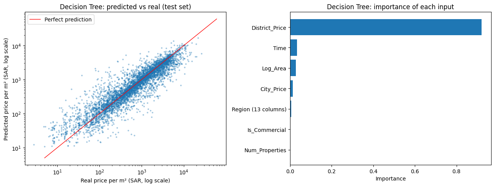
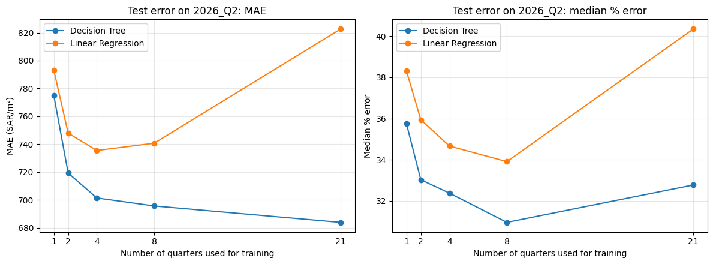

# Saudi Real Estate Price Prediction

Predicting the **price per square metre (SAR/m²)** of Saudi real estate sales from official Ministry of Justice transaction records, using linear regression, a decision tree and a neural network.

## Research question

How accurately can **location, time, area, property type and number of properties** predict the price per m² of a real estate sale?

- **Task A – Regression:** predict the exact price per m².
- **Task B – Classification:** predict the price category (Low / Medium / High).
- **Extra experiment:** does training on more quarters of history improve predictions for the newest quarter?

## Data

- **Source:** Ministry of Justice real estate sales transactions, published quarterly on the [Saudi Open Data Portal](https://open.data.gov.sa/en/datasets/view/34e1da80-d4cd-4d65-bdc8-a8d48a7e7ee2).
- **Coverage:** 22 quarterly files, 2020 Q1 – 2026 Q2 (2023 is not included). 1,290,582 transactions in total.
- **Attributes:** region, city, city/district, reference number, Gregorian and Hijri dates, property classification, number of properties, price and area.

The data files are **not included** in this repository. To run the notebook, download the quarterly Excel files and place them in a `data/` folder named by quarter, for example:

```
data/
├── 2020_Q1.xlsx
├── 2020_Q2.xlsx
├── ...
└── 2026_Q2.xlsx
```

## Method

1. **Cleaning:** remove the identifier and redundant date/city columns, normalize district names (spacing around `/`, the prefix «حي», Arabic letter variants), and keep residential and commercial sales (1,243,119 transactions).
2. **Target:** price per m² = price ÷ area. Models learn its natural log, and predictions are converted back to SAR/m² before measuring the error.
3. **Split first:** 80% training / 20% test, stratified by property type. Everything learned from data comes from the **training set only**.
4. **Outliers:** IQR rule on log(price per m²) for each **city and property type** (national limits for groups with fewer than 30 sales).
5. **Encoding:** target encoding (with smoothing and 5-fold cross-fitting) for district and city, one-hot encoding for region, log of area, and a single time value (year + quarter). 19 model inputs.
6. **Models:** Linear Regression, Decision Tree and a Multi-Layer Perceptron, tuned with 3-fold cross-validation on a 100,000-row training sample, then trained on the full training set.

## Results (test set)

**Task A – Regression**

| Model | MAE (SAR/m²) | Median % error | R² | R² (log) |
|---|---|---|---|---|
| Linear Regression | 546.1 | 32.6% | 0.633 | 0.792 |
| **Decision Tree** | **460.0** | **25.7%** | **0.720** | **0.825** |
| Neural Network | 479.2 | 27.4% | 0.704 | 0.824 |

**Task B – Classification (Low / Medium / High)**

| Model | Accuracy | Macro-F1 |
|---|---|---|
| Always predict one class (baseline) | 0.333 | 0.167 |
| Decision Tree | 0.818 | 0.818 |
| **Neural Network** | **0.822** | **0.822** |

**Key findings**

- **Location matters most:** the district's typical price accounts for about 90% of the decision tree's feature importance.
- The decision tree is the best regression model at every price level; the neural network is slightly ahead for classification.
- For predicting the newest quarter, the most recent one to two years of data are enough; using all history since 2020 hurts linear regression.
- The remaining error mainly reflects information the dataset does not contain (street, plot shape, buildings).

**Decision tree: predicted vs real price, and importance of each input**



### Experiment: how much history do we need?

We predict the newest quarter (2026 Q2) using only the last 1, 2, 4, 8 or all 21 quarters before it.



The most recent one to two years of data are enough. Using all history since 2020 even makes Linear Regression worse.

## How to run

1. Install the requirements:
   ```bash
   pip install -r requirements.txt
   ```
2. Download the 22 quarterly files into `data/` as shown above.
3. Open `SaudiRealEstatePricePrediction_code.ipynb` and run all cells.

**Runtime:** a full run takes about 2 hours, mostly the neural networks on ~1 million rows. To make it faster:

- set `RUN_TUNING = False` to skip the hyperparameter searches (the best settings are already written in the code);
- set `RUN_QUARTER_EXPERIMENT = False` to skip the history experiment;
- set `SAMPLE_SIZE = 100_000` to train on a sample while exploring.

The notebook can also run in Google Colab: upload the `data/` folder or mount Google Drive and point `DATA_DIR` to it.

## Repository structure

```
├── SaudiRealEstatePricePrediction_code.ipynb   # full analysis: preparation, models, evaluation
├── requirements.txt
└── README.md
```

